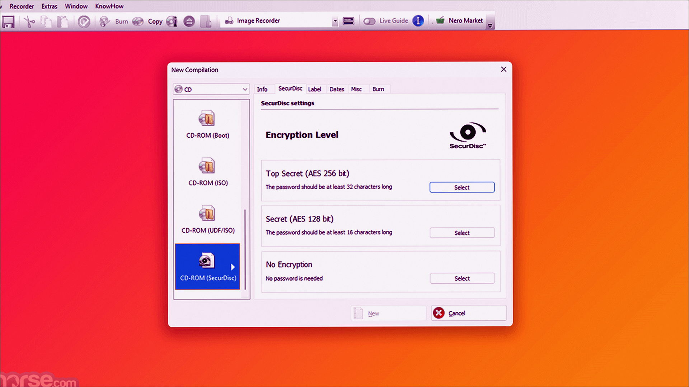
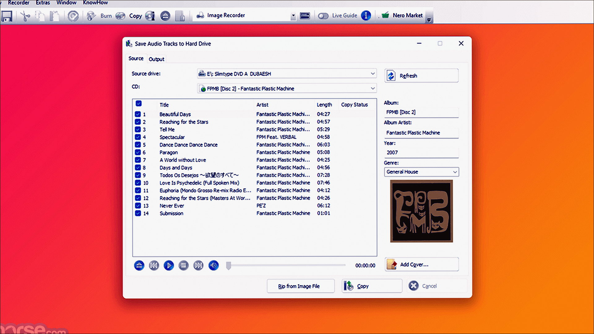
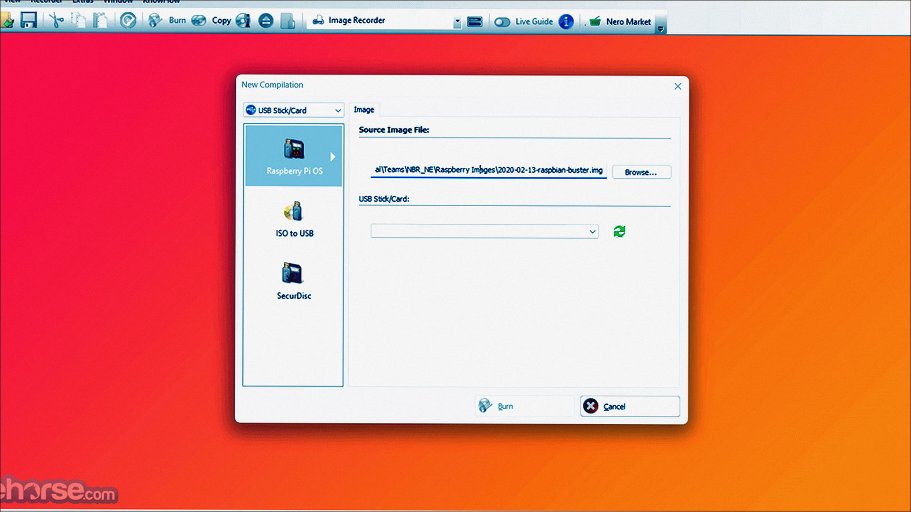

# Windows notes: Nero 2018

**Nero AG** · 2018 · 2.5 MB · System catalog

[Open card](https://moggydayprogram.com/programs/nero) · [English](https://moggydayprogram.com/en/programs/nero) · [GitHub Pages](https://meshherbalistknow.github.io/nero-windows/?lang=en)

  
  
  

Веб-стаб старого Nero. Докачивает пакет сам, нужен интернет.

Nero 2018 on Windows 10/11 x64. 2.5 MB. Requirements, screenshots, MoggyDay Launcher.

Get it from the catalog card, not from this repository.

| Field | Value |
| --- | --- |
| Build | 1.10.0.9 (веб-стаб, триал) |
| OS | Windows 10/11 x64 |
| Pages | https://meshherbalistknow.github.io/nero-windows/ |

- [PowerISO](https://moggydayprogram.com/programs/poweriso)
- [UltraISO](https://moggydayprogram.com/programs/ultraiso)
- [BurnAware Professional](https://moggydayprogram.com/programs/burnaware-professional)
